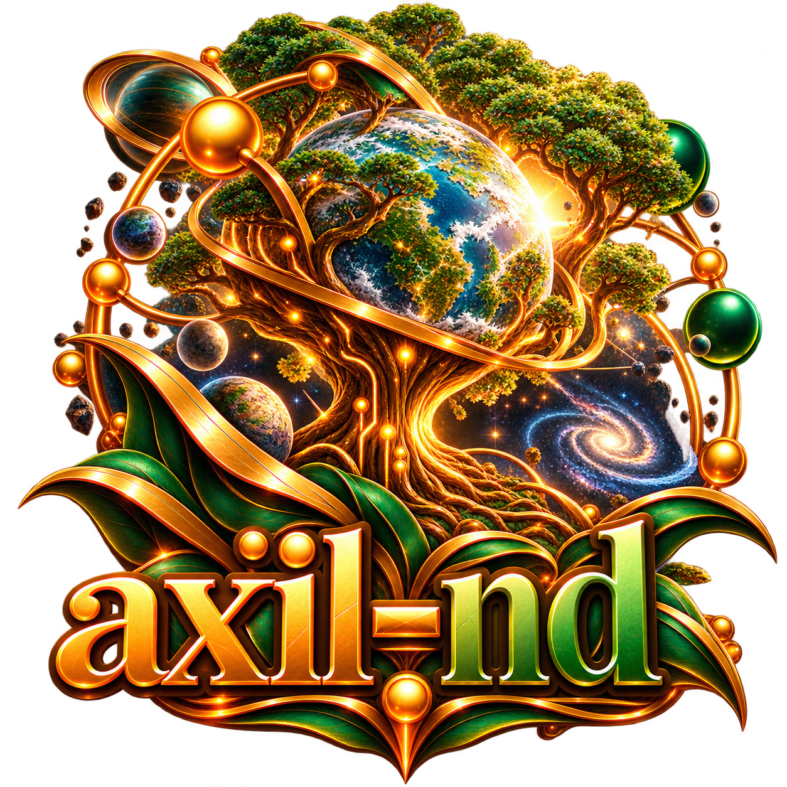

<p align="center">
  
</p>

# axil-nd

[](#)
[](#)
[](#)

> NeverDark MUCK engine as a dynamic [axil](https://github.com/tty-pt/axil)
> module — the game runs in-process behind axil's WebSocket/telnet server.

A port of the [NeverDark](https://github.com/tty-pt/neverdark) MUCK (a
rewrite of TinyMUCK/FuzzBall) built on the axil HTTP/server stack and the
corm database:

- Game engine + region-modded content modules in-process (`loadmod`/
  `unloadmod` into persisted `st` rows, restored every boot; `grant`
  attributes any region — districts, planets, super-planet regions — to any
  player)
- WebSocket + telnet protocol served by axil (`GET:/nd` upgrade)
- Store ported from the legacy `qdb`/`qmap` API to `libcorm`
- Browser client (xterm 6) plus `art/` and the in-game `man/` help pages,
  all installed under `share/axil-nd`

## Architecture & Subsystems

```
┌─────────────────────────────────────────────────────────────────┐
│                          Axil Daemon                            │
│    WebSocket Upgrade (GET /nd)            Raw Telnet Port       │
└────────────────────────────────┬────────────────────────────────┘
                                 │
┌────────────────────────────────▼────────────────────────────────┐
│                        axil-nd Core                             │
│  ┌──────────────────────┐             ┌──────────────────────┐  │
│  │     libcorm Maps     │             │ libislet (3D Space)  │  │
│  │   Objects & Props    │             │  Morton Coordinates  │  │
│  └──────────────────────┘             └──────────────────────┘  │
│  ┌───────────────────────────────────────────────────────────┐  │
│  │ Content Plugins (libxylem): nd-fight, nd-spell, nd-biome  │  │
│  └───────────────────────────────────────────────────────────┘  │
└─────────────────────────────────────────────────────────────────┘
```

The game world is extended through independent libxylem modules:
- Core systems: `nd-core`, `nd-attr`, `nd-class`, `nd-race`, `nd-level`, `nd-mortal`
- World simulation: `nd-biome`, `nd-plant`, `nd-stone`, `nd-seat`, `nd-wts`
- Gameplay & economy: `nd-fight`, `nd-spell`, `nd-equip`, `nd-shop`, `nd-drink`

## In-Game Command Cheat Sheet

| Category | Command | Description |
| :--- | :--- | :--- |
| **Exploration** | `look` (`l`), `examine <obj>` | Inspect your current room or target object |
| **Movement** | `north`, `south`, `east`, `west`, `up`, `down` | Traverse room exits |
| **Communication** | `say <msg>` (`"`), `pose <act>` (`:`), `page <who>=<msg>` | Local conversation and direct whispers |
| **World State** | `who`, `score`, `inventory` (`i`), `help [topic]` | Check active players, attributes, and help |
| **Building** | `@dig <room>`, `@open <exit>=<target>`, `@create <obj>` | Expand rooms and craft items |
| **Modules** | `loadmod <name>`, `unloadmod <name>`, `grant <player>` | Dynamically load game plugins into regions |

## Status

Playable. The engine port is complete and the tree is self-contained: it
builds, tests and runs from a fresh clone with no other checkout required.

## Build from source

The module builds with a plain `make` (the shared [`mk` include.mk]
(https://github.com/tty-pt/mk) is expected as a sibling directory, as is
`axil-tty` for its headers and `libaxil-tty`).

The browser client is **generated** and gitignored, so build it first — a
plain `make` alone leaves `htdocs/` empty and the client 404s:

```sh
npm install           # install build deps
npm run build         # generates htdocs/ (the client)
make                  # builds lib/libaxil-nd.so and generates man/
make test             # run the in-tree test suite (./test.sh)
sudo make install     # module + htdocs + art + man -> $(PREFIX)/share/axil-nd
```

**Dependencies:** `libaxil`, `libcorm`, `libxylem`, `libislet`, `libqsys` and
`axil-tty` (from the tty.pt repo) provide the headers and libraries. All six
are required; the CI dependency list must match `LDLIBS` in the `Makefile`.

## Quick start

The module resolves `art/`, `htdocs/`, `man/` and `motd` through `nd_asset_dir()`,
checking in order:
1. Per-class env `AXIL_ND_<CLASS>` (`AXIL_ND_HTDOCS`, `AXIL_ND_ART`, `AXIL_ND_MAN`, `AXIL_ND_MOTD`);
2. Base directory `AXIL_ND_DATADIR/<dir>`;
3. Compiled `$(PREFIX)/share/axil-nd/<dir>`;
4. Submodule relative path `external/axil-nd/<dir>`;
5. Working directory `<dir>`.

Run it from the checkout root, parent site checkout, or installed `share/axil-nd`:

```sh
axil -d -A -p 8080 -m ./lib/libaxil-nd.so
```

Then play at <http://localhost:8080/nd>, or over telnet:

```sh
nc 127.0.0.1 8080
connect <your-unix-username>
```

The guest name must be a real account on the host — authentication calls
`getpwnam()` and fails otherwise. Over raw telnet, terminate every command
with a blank line, as the reader only dispatches a complete head.

On a development host, point the store somewhere writable:

```sh
mkdir -p var
AXIL_ND_DB=./var/std.db axil -d -A -p 8080 -m ./lib/libaxil-nd.so
```

## The man pages

The 72 in-game help pages (`help <topic>`) are tracked as `man-src/*.10` and
copied into `man/` by the `man` target, which `all` depends on. `man/` is
gitignored build output and is resolved relative to the working directory at
runtime, exactly as `art/` and `htdocs/` are. A bare `help` (or `man`) lists
every installed topic. The editable login notice is the `motd` file, read
from the working directory at login and installed to the share directory by
`install-data`.

## License

BSD 2-Clause License. Copyright (c) 2026, quirinpa. See `LICENSE`, which also
carries the TinyMUCK/FuzzBall GPL lineage note. Components retained from the
original TinyMUCK/FuzzBall codebase remain under the GPLv2; the inherited
`GPL.txt` and `docs/COPYING` are included verbatim in this repository.
